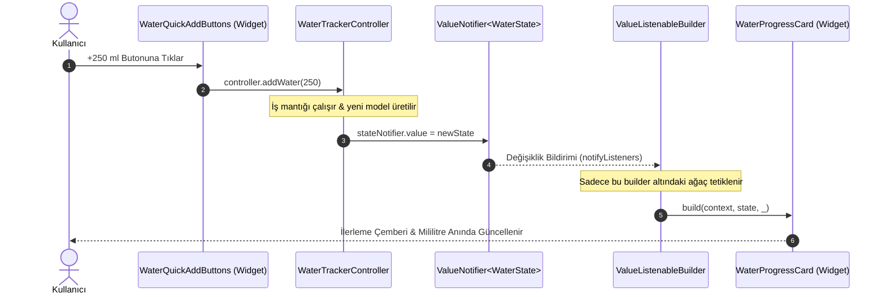

# Reaktif Durum Yönetimi ve Mimari Akış Referansı (State Flow)

Bu doküman, **Susadım** (Akıllı Su, Egzersiz ve Kalori Takip Uygulaması) mimarisinde benimsenen reaktif durum yönetimi (`ValueNotifier`), modüler katman ayrımı ve veri akış prensiplerinin referans kılavuzudur.

> [!IMPORTANT]
> Projede üretilen her kod satırı [project.md](file:///Users/d1-21/19ekim2/project.md) ve [SKILL.md](file:///Users/d1-21/19ekim2/.agents/skills/SKILL.md) belgelerinde tanımlanan kırmızı çizgilere UYMAK ZORUNDADIR.

---

## 1. Temel Prensipler ve Kırmızı Çizgiler

1. **Sıfır Harici State Bağımlılığı (Clean Flutter Native API):**
   - Projeye onay alınmadan harici ağır state kütüphaneleri (Bloc, Riverpod, MobX vb.) EKLENMEYECEKTİR.
   - Flutter'ın yerel ve hafif durum mekanizmaları olan `ValueNotifier<T>` ve `ValueListenableBuilder<T>` kullanılmalıdır.

2. **Sayfa Düzeyinde `setState` Yasağı:**
   - Sayfa (Screen/View) düzeyinde tüm ekranı yeniden tetikleyen devasa `setState` çağrıları kesinlikle yasaktır.
   - Yalnızca yerel arayüz durumunu yöneten (örneğin buton animasyonları, mikro geçişler) atomik `StatefulWidget` yapılarına izin verilir.

3. **Performans ve `const` Zorunluluğu:**
   - Statik tüm widget'larda `const` yapıcı zorunludur. Böylece gereksiz widget re-instantiation önlenir.
   - `build` metotları 40 satırı geçemez. 40 satırı aşan veya modüler hale getirilebilecek her parça `widget/` klasörü altına bağımsız widget olarak ayrılmalıdır.

4. **Tema Bütünlüğü:**
   - Doğrudan `Colors.red`, `Colors.black` gibi sabit renkler yazılması yasaktır.
   - Renk ve tipografi stilleri `Theme.of(context).colorScheme` ve tema tokens üzerinden çekilmelidir.

---

## 2. Katmanlar ve Sorumluluk Dağılımı

Uygulama **özellik bazlı (feature-based)** mimari yapısına göre organize edilir:

```text
lib/features/<feature_name>/
    ├── controller/          # Reaktif durum ve iş mantığı (ValueNotifier, dispose)
    │   └── <feature>_controller.dart
    ├── models/              # Değişmez veri modelleri (@immutable, copyWith, JSON)
    │   └── <feature>_model.dart
    ├── view/                # Yalnızca UI iskeleti ve Scaffold (StatelessWidget)
    │   └── <feature>_view.dart
    └── widget/              # <40 satır atomik UI bileşenleri (const, Theme uyumlu)
        ├── <feature>_progress_card.dart
        └── <feature>_action_buttons.dart
```

### Katman Rolleri

| Katman | Sorumluluk | İzin Verilenler | Yasaklananlar |
| :--- | :--- | :--- | :--- |
| **Model** | Veri tanımı, serileştirme | `final` alanlar, `copyWith`, `fromJson`, `toJson`, `==/hashCode` | İş mantığı, UI bağımlılığı (`BuildContext`) |
| **Controller** | İş kuralları, durum tutma | `ValueNotifier<T>`, metotlar, `dispose()` | Widget import'u, `BuildContext` referansı |
| **View** | Sayfa iskeleti, layout | `StatelessWidget`, `ValueListenableBuilder`, `Scaffold`, `AppBar` | Doğrudan iş mantığı, devasa `build()` (>40 satır) |
| **Widget** | Alt bileşenler, sunum | `const StatelessWidget`, `Theme.of(context).colorScheme`, callback'ler | Global state başlatma, kontrolsüz rebuild |

---

## 3. Reaktif Durum Akış Şeması (Data Flow)

Aşağıdaki diyagramda kullanıcının bir eylem gerçekleştirmesinden (örneğin su ekleme butonuna basılması) sadece ilgili arayüz parçasının güncellenmesine kadar olan tek yönlü veri akışı (Unidirectional Data Flow) gösterilmektedir:



### Akış Özellikleri:
1. **Tek Yönlü Veri Akışı (Unidirectional Flow):** View -> Controller -> State -> View.
2. **Seçici Yeniden Çizim (Selective Rebuild):** Ekrandaki `AppBar`, arka plan ve butonlar yeniden çizilmez; yalnızca `ValueListenableBuilder` altındaki `WaterProgressCard` yeniden oluşturulur.
3. **Maksimum 60/120 FPS Performansı:** Gereksiz CPU ve GPU maliyeti sıfıra indirgenir.

---

## 4. Durum Yönetimi Karşılaştırması

| Kriter | Standart `setState` | Bizim Modelimiz: `ValueNotifier` | Ağır Paketler (Bloc/Riverpod) |
| :--- | :--- | :--- | :--- |
| **Kapsam** | Tüm sayfayı yeniden çizer | Yalnızca dinleyen widget'ı çizer | Seçici çizim |
| **Bağımlılık** | Sıfır | **Sıfır (Saf Flutter Çekirdeği)** | Harici paket (pub.dev) |
| **Boilerplate Kodu** | Çok az ama spagetti | **Minimal ve okunabilir** | Yüksek (Event, State, Provider) |
| **Test Edilebilirlik** | Zor (Widget context gerektirir) | **Çok kolay (Saf Dart birim testi)** | Kolay ama karmaşık mocklar |
| **Performans** | Düşük (Gereksiz rebuild) | **Çok Yüksek** | Yüksek |

---

## 5. Yaşam Döngüsü ve Bellek Yönetimi (Memory Management)

`ValueNotifier`, işletim sistemi kaynaklarını dinlemek için dahili `ChangeNotifier` tabanlı dinleyici listesi tutar. Bu nedenle controller temizliği kritik öneme sahiptir:

```dart
// Controller içinde dispose kuralı
class WaterTrackerController {
  final ValueNotifier<WaterTrackerState> stateNotifier;

  WaterTrackerController({WaterTrackerState? initialState})
      : stateNotifier = ValueNotifier<WaterTrackerState>(
          initialState ?? const WaterTrackerState(),
        );

  void dispose() {
    stateNotifier.dispose(); // Bellek sızıntısını (memory leak) önler
  }
}
```

> [!CAUTION]
> Controller içinde açılan her `ValueNotifier` mutlaka `dispose()` edilmelidir. View düzeyinde controller barındırıldığında sayfa kapandığında `dispose()` çağrısının yapıldığından emin olunmalıdır.

---

## 6. Tema Yönetimi ve Senkronizasyon Akışı

Susadım projesinde tema, `core/theme/theme_controller.dart` dosyasındaki `ValueNotifier<ThemeMode>` ile yönetilir. Sistem modu (`ThemeMode.system`), karanlık spor salonu paleti (`ThemeMode.dark`) ve sportif modern aydınlık palet (`ThemeMode.light`) desteklenir.

```mermaid
graph TD
    DeviceSystem[Cihaz Sistem Teması] -->|Senkronizasyon| ThemeController[ThemeController: ValueNotifier&lt;ThemeMode&gt;]
    UserToggle[Tema Butonu Tıklaması] -->|Manuel Geçiş| ThemeController
    ThemeController -->|Reaktif Bildirim| MaterialApp[MaterialApp.router / MaterialApp]
    MaterialApp -->|ThemeData.dark / light| ColorScheme[Theme.of(context).colorScheme]
    ColorScheme -->|Token Kullanımı| FeatureWidgets[Tüm Feature Widget'ları]
```

### Tema Kullanım Kuralı:
```dart
// DOĞRU:
final colorScheme = Theme.of(context).colorScheme;
Container(
  color: colorScheme.surface,
  child: Text('Su Seviyesi', style: TextStyle(color: colorScheme.onSurface)),
);

// YANLIŞ (Kırmızı Çizgi İhlali):
Container(
  color: Colors.white, // Hardcoded renk YASAKTIR!
  child: Text('Su Seviyesi', style: TextStyle(color: Colors.black)),
);
```

---

## 7. Geliştirici Doğrulama Kontrol Listesi

Bir özelliği tamamlamadan veya yeni bir modül açmadan önce şu adımlar doğrulanmalıdır:

- [ ] Modül `lib/features/<feature>/` altında `controller/`, `models/`, `view/`, `widget/` olarak ayrıldı mı?
- [ ] Controller `ValueNotifier` kullanıyor ve `dispose()` metodu var mı?
- [ ] Model `@immutable`, `const` yapıcıya ve `copyWith` / `fromJson` / `toJson` metotlarına sahip mi?
- [ ] `build` metotları 40 satırın altında mı?
- [ ] Tüm statik widget'larda `const` kullanıldı mı?
- [ ] Renkler `Theme.of(context).colorScheme` üzerinden mi alındı?
- [ ] `flutter analyze` komutu **0 uyarı, 0 hata** verdi mi?
- [ ] `flutter test` ile controller birim testleri başarıyla geçti mi?
